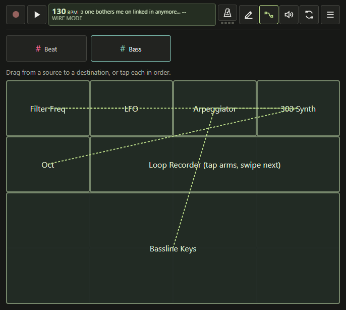

# Controls and modulation

## Control types

The grid control picker provides nine control families:

| Control | Purpose |
| --- | --- |
| Pad | Trigger a connected control |
| Instrument Pad | Play an instrument |
| Knob | Produce a numeric value |
| LFO | Produce a periodic modulation signal |
| Mod Wheel | Produce manual modulation |
| Piano Roll | Play pitched notes |
| Arpeggiator | Transform held notes into a sequence |
| Output Selector | Select among output destinations |
| Loop Sequencer | Record and play clips |

Each control exposes outputs and/or inputs appropriate to its role. The settings dialog previews the live control while parameters are edited.

For a Pad, position-based velocity and pressure reach their maximum in the bottom 20% of the pad. When rotated, this region is on the left. Pressure-sensitive input uses the reported pressure instead.

Knob dragging uses at least 100 pixels for the full range, or one pixel per step when that requires more travel.

## Wiring controls

Choose **Wire**, then select a source and destination control. GroovePad filters the available parameters to compatible connections. A connection can use:

- **Absolute mapping**: map the source range into a target range.
- **Modulation**: apply a relative offset, with a configurable amount or range.

Connections are validated before they are saved. Existing wires can be edited or removed from control settings. Cycles and duplicate source/target mappings are rejected.

## Automation

Knobs, mod wheels, LFOs, piano rolls, arpeggiators, instrument pads, and loop sequencers expose parameters that can be used by modulation and loop automation. When a loop records automation, the source and parameter are stored alongside note events and replayed with the selected clip.

## Note repeat

Activate **Note repeat** and choose 1/4, 1/8, 1/16, or 1/32. Pad and note controls then repeat input at the selected transport division while playback is running.

[← Previous: Banks and grid editing](./banks-and-grid.md) · [Next: Synth instruments →](./instruments-and-sound.md)

