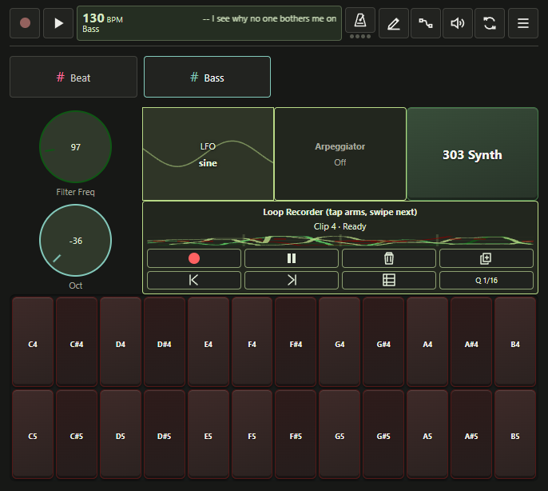

# Getting started

## Open the workspace

When GroovePad starts, it loads the saved local project. If no saved project exists, it loads the default project template. Audio is started by the first user interaction required by the browser.

The workspace is organised as:

1. Transport and project controls at the top.
2. Bank tabs below the header.
3. The selected bank's grid in the main workspace.
4. Optional dialogs for project, bank, control, and asset settings.

## Install GroovePad as a PWA

GroovePad is packaged as a Progressive Web App. Use a current browser such as Chrome, Edge, or Safari:

1. Open the hosted GroovePad site.
2. Open the browser's install control. In Chromium browsers this is the install icon in the address bar or **Menu → Install GroovePad**. On iOS/iPadOS Safari use **Share → Add to Home Screen**.
3. Confirm the installation.
4. Launch GroovePad from the new desktop, dock, or home-screen icon.

The installed version opens in a standalone app window instead of a normal browser tab. This gives a cleaner performance surface, a dedicated launch shortcut, and a layout that is better suited to touch devices. The app can also cache its application shell for more reliable repeat launches; audio and project data still depend on the browser and device permissions.

## Make a first sound

1. Select an instrument pad, piano roll, or pad in the current grid.
2. Press or click the control.
3. Use the Play button to start transport playback where a loop is armed.
4. Adjust BPM by clicking the tempo value.
5. Turn on the metronome if you need a timing reference.

## Use tools

The toolbar changes how grid gestures are interpreted:

- **Edit** adds and rearranges controls.
- **Wire** creates connections between controls.
- **Volume** exposes volume interaction for instruments and loop sequencers.
- **Note repeat** repeats pad or note input at a selected division.

Click an active tool again to leave that mode.

[← Manual home](./README.md) · [Next: Transport and project management →](./transport-and-projects.md)

