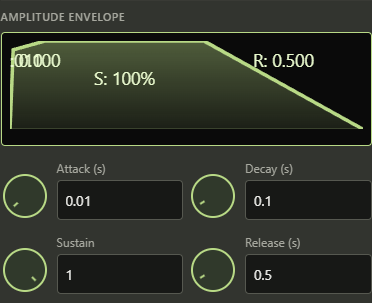

# Synth instruments

Instrument pads are the sound-producing controls in GroovePad. Add an Instrument Pad, then choose a synthesised instrument type in Control settings. For sample-based instruments, see the [Sampler](./sampler.md) chapter.

## Bass 303

The 303 model is a monophonic acid-style synthesizer. Use it for squelchy bass lines and resonant sequences.

- **Transpose** shifts the note in semitones.
- **Resonance** emphasizes the filter cutoff region.
- **Filter frequency** sets the cutoff point.
- **Filter amount** controls how strongly the filter envelope moves the cutoff.
- **Filter envelope** shapes that movement over time.
- **Slide time** controls the glide between notes.
- **Volume** and the amplitude envelope shape the final sound.

The 303 responds especially well to short decay, low sustain, and moderate-to-high resonance.

## 808

The 808 model provides synthetic drum voices with a rounded, electronic character.

- **Voice**: kick, snare, closed hat, open hat, rim, or tom.
- **Pitch** changes the voice's fundamental character.
- **Tonality** balances tonal and noisy content.
- **Tone** adjusts the voice brightness.
- **Volume** and the envelope control its place in the mix.

Use the 808 kick for sub-heavy pulses and the hats for crisp repeated rhythm.

## 909

The 909 exposes the same voice families and broad controls as the 808, but produces a brighter, more aggressive drum-machine character. Use pitch and tone to separate it from other drum voices, then use the envelope to shorten or lengthen the hit.

## Envelopes and waveforms

ADSR editors expose attack, decay, sustain, and release. The visualizer shows the resulting envelope shape. Sample and waveform editors provide visual region selection and cut editing where the instrument supports it.

The envelope is available on the synth and sampler instruments. Use short attack and release values for percussive sounds; increase them for softer pads and transitions. Sustain controls the level held during a sustained note, while decay controls how quickly the sound reaches that level after its initial peak.

Instrument audio is managed through Tone.js and is disposed when controls are replaced or removed. To combine these instruments with samples, continue to [Sampler](./sampler.md).

[← Previous: Controls and modulation](./controls-and-modulation.md) · [Next: Sampler →](./sampler.md)

