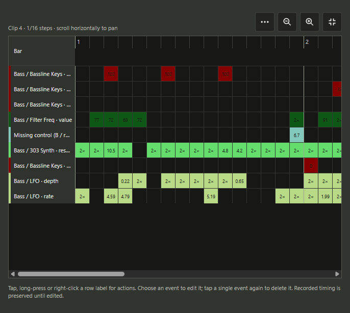

# Loops and sequencing

## Loop Sequencer

A Loop Sequencer stores multiple clips of notes and automation. Its compact widget can expose:

- Play/pause
- Arm recording
- Clear the current clip
- Clone a clip
- Move to the next or previous clip
- Open the editor
- Cycle quantisation

The visible buttons are configurable in loop settings.

## Recording a clip

1. Add an Instrument Pad or other note source.
2. Add a Loop Sequencer.
3. Choose a clip and arm recording.
4. Set count-in, metronome, sync mode, quantisation, and recording scope as needed.
5. Play the source control while transport is running.
6. Disarm or stop recording, then play the clip.

Recording scope controls whether events from the current bank or all banks are captured. Loop notes may target instruments in another bank, so complete-project loading is required to preserve those references.

## Sequenced Loop Editor

The editor represents note rows and automation rows over the clip timeline. Notes store instrument, pitch, velocity, position, duration, and optional pitch bend. Automation stores source, parameter, value, position, and active state.

Clips are bounded by bar length and the supported clip range. Quantisation can be off or set to 1/4, 1/8, 1/16, or 1/32.

[← Previous: Sampler](./sampler.md) · [Next: Sample assets →](./assets.md)

