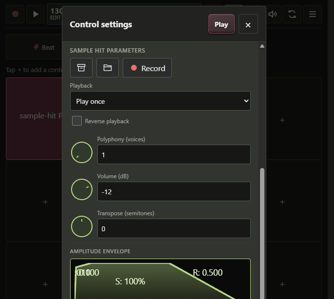

# Sampler

GroovePad has two sample-based instruments: **Sample Hit** for triggered sounds and **Sample Loop** for sustained sample playback. Add an Instrument Pad in Edit mode, then choose one of these instrument types in Control settings.

## Sample Hit

Sample Hit is suited to drums, one-shots, vocal fragments, and chopped phrases.

### Sample and region

- Load a sample into the instrument.
- Set the start and end points of the playable region.
- Add cut points to divide the region into slices.
- Choose ordered playback or random playback.

### Trigger behaviour

- **Once** plays the selected region once.
- **Loop** repeats the region while the control is held or toggled.
- **Back-and-forth** alternates playback direction on each loop.
- **Reverse** plays the region backwards.
- **Polyphony** controls how many overlapping voices can play.
- **Pitch** transposes playback by semitones.
- **Volume** sets the instrument level.

### Envelope

Use the ADSR envelope to shape each hit:

- **Attack** fades the sound in.
- **Decay** moves from the peak to sustain level.
- **Sustain** holds the level while the sound remains active.
- **Release** fades the sound out.

## Sample Loop

Sample Loop is suited to beds, textures, and phrases that should continue while a control is active. Set the loop start and end points, then adjust cuts, playback, pitch, volume, and the ADSR envelope.

Unlike Sample Hit, Sample Loop is designed around a sustained loop region rather than a one-shot trigger. Use it with a Loop Sequencer when you want the loop to be started and stopped in a repeatable arrangement.

## Practical workflow

1. Add an Instrument Pad.
2. Select Sample Hit or Sample Loop.
3. Load or choose a project sample.
4. Trim the region and set playback behaviour.
5. Adjust pitch and volume.
6. Shape the envelope.
7. Trigger the pad or connect it to another control in Wire mode.

[← Previous: Synth instruments](./instruments-and-sound.md) · [Next: Loops and sequencing →](./loops-and-sequencing.md)
